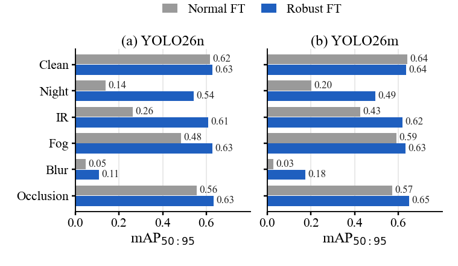

# Robust wildlife detection and alerts: test code, data and weights

With this repository, you can re-run the paper's real-world tests on:

- **real images:** detection accuracy, plus the ALERT/LOG decision for each image;
- **a real camera-trap video:** the alert timeline.

Four trained detectors are provided: YOLO26n and YOLO26m, each with **normal** fine-tuning (clean images only) and **robust** fine-tuning (each training image plus one synthetic night, IR, fog, motion-blur or occlusion copy).

No training code or training data is needed to run the tests.

## Examples

**The ten classes.** The *Domestic* class merges cows and goats.


**Synthetic conditions used for robust fine-tuning.** The box (magenta) is drawn once on the clean image. It stays valid in every condition, so no new labels are needed. The night image is brightened here for display.


**Synthetic test results (mAP50-95).** Robust fine-tuning recovers most of the loss at night and under IR, and clean accuracy does not drop.



**Real camera-trap video (YOLO26m).** Both panels show the same frame at 34 s:
- the normal model misses the tiger, so it only logs;
- the robust model finds it and raises an ALERT.

The timeline below them shows when each model's alert is on. The alert is on when 2 of the last 3 frames are ALERT.


## Get the data, weights and video

The images, video and weights (about 196 MB) are in this Google Drive folder:
**[wildlife-alert-data](https://drive.google.com/drive/folders/110E8umWRAlWJeEi400wlHsWi5FM00Wo7?usp=sharing)**

1. Open the link and click **Download** (top right). Google Drive sends the folder as a zip.
2. Unzip it.
3. Place the three folders `data/`, `videos/` and `weights/` next to the test scripts.
4. Run `python test_real_images.py --check` to confirm that the data is in the right place.

The layout should be:

```
data/WM-10-CameraTrap/
  images/{day,fog,night,ir}/   183 real images (day 33, fog 54, night 53, IR 43)
  labels/{day,fog,night,ir}/   YOLO labels (class x_center y_center width height, normalised)
  conditions.csv               image, class, condition, number of boxes
videos/
  GF5LRYXabHU.mp4              50 s night/IR camera-trap clip (leopard, then tiger)
  GF5LRYXabHU_groundtruth.csv  when a dangerous animal is on screen (start_s, end_s)
  sources.csv                  source of the video
weights/
  yolo26n_normal.pt  yolo26n_robust.pt  yolo26m_normal.pt  yolo26m_robust.pt
```

The repository itself holds:

```
test_real_images.py   real-image test: mAP per condition + ALERT/LOG confusion matrix
test_video.py         video test: ALERT/LOG per frame, smoothed alert timeline, scores
expected_results/     our numbers; the scripts print them next to yours
assets/               the example figures above
```

## Quick start (Google Colab)

First download the Drive folder as a zip (see above). In Colab, upload the zip with the Files panel on the left, then run:

```python
!git clone <this repository URL> repo
%cd repo
!pip install -q -r requirements.txt
!unzip -q -o "/content/*.zip" -d /content/dl
!D=$(dirname "$(find /content/dl -type d -name data | head -1)"); cp -r "$D/data" "$D/videos" "$D/weights" .
!python test_real_images.py --check          # data check only (no model is run)
!python test_real_images.py --save-images    # 4 models on the 183 real images
!python test_video.py --save-video           # 4 models on the video
```

On your own machine, run the same commands without `!` (Python 3.10 or newer). A GPU is optional.

Options:
- `--device cpu` or `--device 0` chooses the device. By default, the GPU is used if there is one.
- `--weights weights/yolo26m_robust.pt` tests one model only.
- `python <script> -h` lists all options.

Outputs go to `results/real_images/` and `results/video/`:
- `--save-images` writes every test image with its predicted boxes. A banner shows the true and predicted decision: green if they match, red if not.
- `--save-video` writes one annotated clip per model.

## Classes and decisions

| ID | Class | Decision |
|---|---|---|
| 0 | Domestic (cow, goat) | LOG |
| 1 | Elephant | ALERT |
| 2 | Pygmy Hog | LOG |
| 3 | Buffalo | ALERT |
| 4 | Monkey | LOG |
| 5 | Deer | LOG |
| 6 | Leopard | ALERT |
| 7 | Rhino | ALERT |
| 8 | Royal Bengal Tiger | ALERT |
| 9 | Asiatic Black Bear | ALERT |

- An image or video frame is **ALERT** if any ALERT class is detected with confidence at least 0.25. Otherwise it is **LOG**.
- If several animals are detected, ALERT wins over LOG.
- In the video, the alert is ON when at least 2 of the last 3 sampled frames (5 frames per second) are ALERT.

## Expected results

### Real images: mAP50-95 per condition

| Model | Day | Fog | Night | IR | Mean |
|---|---|---|---|---|---|
| YOLO26n normal | 0.270 | 0.177 | 0.101 | 0.142 | 0.173 |
| YOLO26n robust | 0.283 | 0.230 | 0.142 | 0.155 | 0.203 |
| YOLO26m normal | 0.315 | 0.202 | 0.133 | 0.150 | 0.200 |
| YOLO26m robust | 0.287 | 0.256 | 0.163 | 0.171 | 0.219 |

These use the default Ultralytics validation settings, with image size 640 and batch size 32.

### Real images: ALERT / LOG confusion

There are 183 images: 112 need an ALERT and 71 are LOG.

| Model | True ALERT → ALERT | True ALERT → LOG (missed) | True LOG → ALERT (false) | True LOG → LOG |
|---|---|---|---|---|
| YOLO26n normal | 44 | 68 | 13 | 58 |
| YOLO26n robust | 67 | 45 | 2 | 69 |
| YOLO26m normal | 50 | 62 | 3 | 68 |
| YOLO26m robust | 70 | 42 | 1 | 70 |

### Video: GF5LRYXabHU

A dangerous animal is on screen for 49.4 s of the clip. The table shows the smoothed alert.

| Model | Alert ON (s) | Correct (s) | False (s) | Coverage | Alert onsets |
|---|---|---|---|---|---|
| YOLO26n normal | 29.2 | 28.6 | 0.6 | 57.9% | 6 |
| YOLO26n robust | 39.6 | 39.0 | 0.6 | 78.9% | 5 |
| YOLO26m normal | 22.6 | 22.6 | 0.0 | 45.7% | 4 |
| YOLO26m robust | 39.4 | 39.4 | 0.0 | 79.8% | 3 |

Our image results were computed on an NVIDIA P100 GPU with `ultralytics==8.4.175`. A different GPU, a CPU, or another library version can change the values in the third decimal place. It can also change single image decisions.

## Data notes

- The WM-10-CameraTrap images are frames from publicly available wildlife videos (camera-trap, CCTV and other footage). None of them were used for training.
- The boxes were drawn by hand.
- The test video comes from a public source, listed in `videos/sources.csv`.
- These files are shared only so that the paper's results can be checked.
